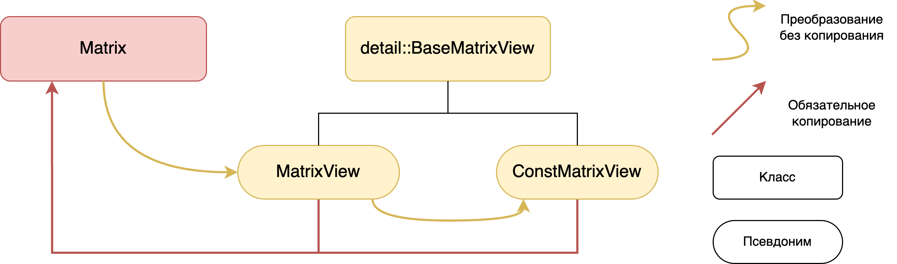
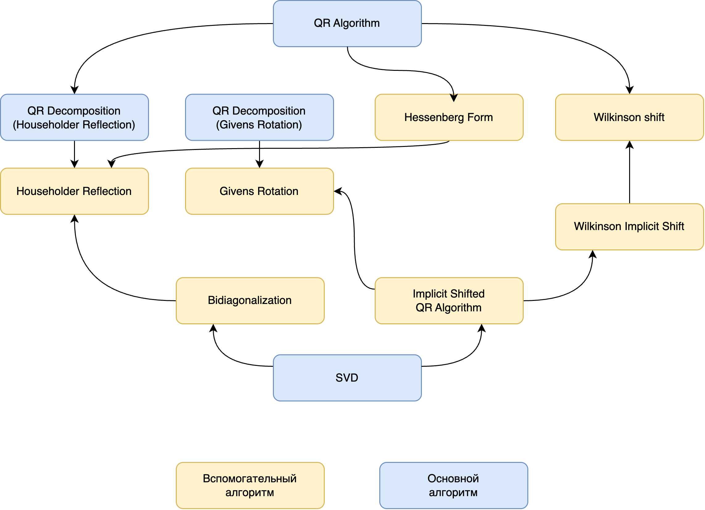

# Numerical Linear Algebra Library

[](https://isocpp.org/)

A modern C++ library for numerical linear algebra, focusing on matrix operations, a variety of matrix iterators, and advanced linear algebra algorithms.

> **Note:** This library requires **C++20**. Many features rely on concepts and other improvements introduced in the C++20 standard.

## Features

- **Matrix Class**: Powerful and flexible matrix class supporting various data types and operations.
- **Matrix Views**: Efficient, non-owning views for matrix slicing and submatrices.
- **Iterators**: Multiple iterator types for traversing rows, columns, and submatrices.
- **Linear Algebra Algorithms**:
  - QR Decomposition (Householder and Givens methods)
  - Hessenberg Form and Implicit QR Algorithms
  - Wilkinson Shift and Implicit Shifted QR
  - Singular Value Decomposition (SVD)
  - Bidiagonalization
- **C++20 Standard**: Extensively uses C++20 concepts and other modern language features.

## Matrix Design



- **Matrix**: Main data container
- **detail::BaseMatrixView**: Internal base for views
- **MatrixView / ConstMatrixView**: Non-owning views for efficient matrix operations

## Algorithms Overview



- Comprehensive support for QR-based algorithms and SVD
- Modular structure: Each algorithm is implemented as a reusable component

## Example Usage

```cpp
#include <iomanip>
#include <ios>
#include <iostream>

#include "src/matrix.h"
#include "src/svd.h"

namespace linalg::test {
void Demo() {
    Matrix<long double> matrix_long_double{
        {4, 43, 12, 3},
        {43, 5, 2, 4},
        {12, 2, 6, -3},
        {3, 4, -3, 7},
    };

    auto svd_res = SVD(matrix_long_double);

    std::cout << std::fixed << std::setprecision(2);
    std::cout << "U matrix:\n" << svd_res.u << "\n\n";
    std::cout << "S matrix:\n" << svd_res.s << "\n\n";
    std::cout << "VT matrix:\n" << svd_res.vt << "\n\n";

    auto prod = svd_res.u * svd_res.s * svd_res.vt;
    std::cout << "Reconstructed matrix:\n" << prod << "\n\n";

    auto submatrix =
        matrix_long_double.Submatrix(SubmatrixRange::FromBeginSize(ERowBegin{0}, ERows{3}, EColBegin{0}, ECols{3}));

    std::cout << "Submatrix:\n" << submatrix << "\n";
}
} // namespace linalg::test

int main() {
    linalg::test::Demo();
    return 0;
}
```

## Usage

- Include headers from `src/` in your C++ project.
- See the example above for SVD; similar usage applies to other algorithms.

## License

Licensed under your chosen license. See [LICENSE](LICENSE) for details.

---

**Note:** Some diagrams contain Russian text for "Class" (`Класс`), "Alias" (`Псевдоним`), "Auxiliary algorithm" (`Вспомогательный алгоритм`), and "Main algorithm" (`Основной алгоритм`).

For further details, refer to source code and documentation comments.
